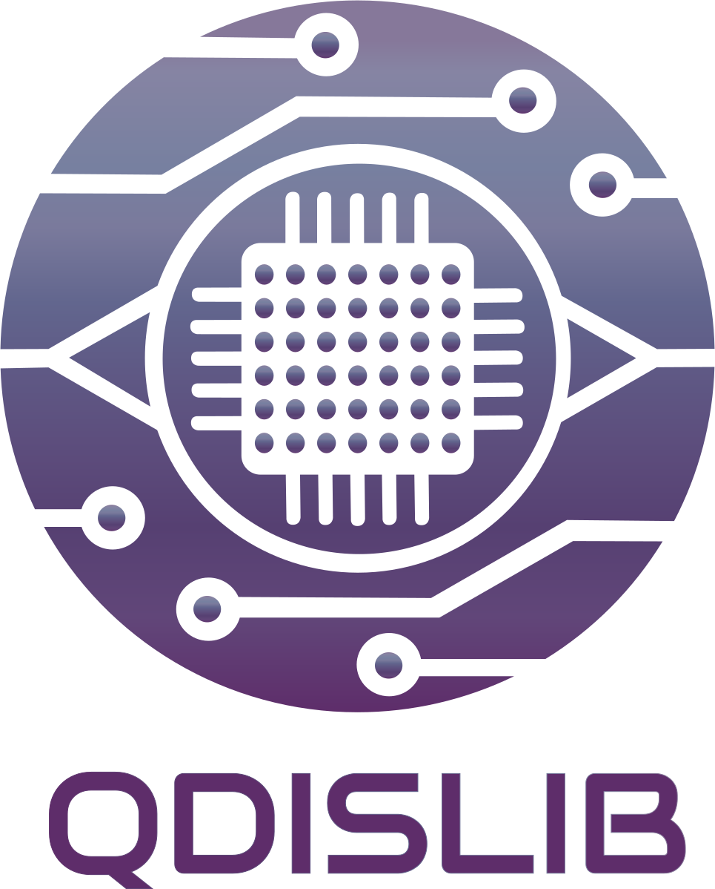

<h1 align="center">
    
</h1>

<h3 align="center">Quantum distributed computing library implemented over PyCOMPSs programming model for HPC.</h3>

<p align="center">
  <a href="https://qdislib.readthedocs.io/?badge=latest">
    
  </a>
  <a href="https://badge.fury.io/py/qdislib">
      
  </a>
  <a href="https://badge.fury.io/py/qdislib">
      
  </a>
</p>

<p align="center"><b>
    <a href="https://qdislib.readthedocs.io">Documentation</a> •
    <a href="https://qdislib.readthedocs.io/en/latest/examples.html">Notebooks</a> •
    <a href="https://github.com/bsc-wdc/qdislib/releases">Releases</a> •
    <a href="https://bit.ly/bsc-wdc-community">Slack</a>
</b></p>

**Qdislib** runs quantum circuits by **cutting** them into smaller subcircuits, running those independently, and reconstructing the result of the original circuit. It runs serially on a laptop or in parallel on HPC with [PyCOMPSs](https://compss-doc.readthedocs.io/), on simulators, GPUs and QPUs.

Use it to run a circuit too wide for your device or simulator, when a few cuts split it. Each cut multiplies the shots a given precision needs, so the number of cuts is what limits it.

## What it does

- **Three kinds of cut, in any mix** (`circuit_cutting`): measure-and-prepare gate cuts that follow the gate's angle, Hadamard gate cuts with no mid-circuit measurement, and wire cuts.
- **Expectation values and distributions.** Pauli strings and Hamiltonians; output distributions, marginals with `qubits=`, and `FactoredDistribution` over more than 24 qubits.
- **Finding cuts** (`find_cut`): for a size, by cost over all kinds of cut (`mixed=True`), or for a device's connectivity (`coupling_map`). `cutting_overhead` gives the cost of a cut before running it.
- **Shots and error bars.** `error=`, `total_shots=`, `num_samples=` and `shots_for`.
- **Any SDK.** Circuits from Qiskit, Qibo, CUDA-Q, PennyLane and QiliSDK, run on any of them. `qd.BaseBackend` adds your own in one method.
- **PyCOMPSs.** Every fragment circuit is a task, including GPU tasks. Without PyCOMPSs it runs serially, with the same results.
- **QPUs.** IBM, IQM and BSC devices, and `qd.pack` to run many subcircuits in one job.
- **A cache** of fragment results, across observables and runs.

## Installation

Python 3.10 or later, and at least one quantum SDK, installed as an extra:

```bash
pip install "qdislib[qiskit]"     # or [qibo], [cudaq], [pennylane], [qilisdk], [all]
```

To run in parallel, install [PyCOMPSs](https://compss-doc.readthedocs.io/en/stable/Sections/01_Installation_Configuration.html) 3.3 or later, which `pip` does not do for you. Without it Qdislib runs serially. See [QUICKSTART.md](QUICKSTART.md) for more.

## A first cut

```python
from qiskit import QuantumCircuit
import Qdislib as qd

circuit = QuantumCircuit(5)
for qubit, angle in enumerate([0.8, 0.5, 0.6, 0.4, 0.3]):
    circuit.ry(angle, qubit)
for qubit in range(4):
    circuit.cz(qubit, qubit + 1)

cut = qd.find_cut(circuit, max_qubits=3, wire_cut=False)
print(cut)                                # ['CZ_7']
print(qd.cutting_overhead(circuit, cut))
# {'subcircuits': 12, 'configurations': 6, 'fragments': 2, 'gamma': 3.0}

value = qd.gate_cutting(circuit, cut, shots=8192, seed=1, error=True)
print(value)                              # 0.441427 ± 0.0082
print(qd.analytical_solution(circuit, "ZZZZZ"))   # 0.4440, exact
```

To run the subcircuits yourself, on your own devices or with your own tools, split the call in three:

```python
subcircuits = qd.gate_cutting_subcircuits(circuit, cut, "ZZZZZ")       # 1. cut
values = [qd.expectation_value(s, shots=8192) for s in subcircuits]    # 2. run: this loop is yours
print(subcircuits.reconstruct(values))                                 # 3. recombine
```

Run the same script with `runcompss --pythonpath=$(pwd) my_app.py` to run its circuits in parallel.

The [notebooks](https://qdislib.readthedocs.io/en/latest/examples.html) go through all of it with results and figures, and open in Colab or Binder. To look around with nothing to install, [try it in your browser](https://qdislib.readthedocs.io/en/latest/try.html).

## Availability

These supercomputers have PyCOMPSs and Qdislib installed. For help configuring your own cluster, write to support-compss@bsc.es.

- MareNostrum 5, Barcelona Supercomputing Center (BSC): see [the HPC guide](https://qdislib.readthedocs.io/en/latest/guide/hpc.html)


## Citing Qdislib

If you use Qdislib in a scientific publication, we would appreciate citations to
the following papers. Please cite the original paper (ACM, SC '25 Workshops)
first:

M. Tejedor, B. Casas, J. Conejero, A. Cervera-Lierta and R. M. Badia,
"Orchestrating Quantum-HPC Workflows with Distributed Quantum Circuit Cutting,"
in *Proceedings of the SC '25 Workshops of the International Conference for High
Performance Computing, Networking, Storage and Analysis*, ACM, 2025, pp.
1898–1906. https://doi.org/10.1145/3731599.3767547

M. Tejedor, J. Conejero and R. M. Badia, "A Semantic Quantum Circuit Cache for
Scalable and Distributed Quantum-Classical Workflows," arXiv:2604.26788, 2026.
https://arxiv.org/abs/2604.26788

### Bibtex:

```latex
@inproceedings{Qdislib,
    title     = {{Orchestrating Quantum-HPC Workflows with Distributed Quantum Circuit Cutting}},
    author    = {Mar Tejedor and Berta Casas and Javier Conejero and Alba Cervera-Lierta and Rosa M. Badia},
    booktitle = {Proceedings of the SC '25 Workshops of the International Conference for High Performance Computing, Networking, Storage and Analysis},
    publisher = {ACM},
    pages     = {1898--1906},
    year      = {2025},
    doi       = {10.1145/3731599.3767547},
}

@article{QdislibCache,
    title   = {{A Semantic Quantum Circuit Cache for Scalable and Distributed Quantum-Classical Workflows}},
    author  = {Mar Tejedor and Javier Conejero and Rosa M. Badia},
    journal = {arXiv preprint arXiv:2604.26788},
    year    = {2026},
}
```

## URLs

- [Documentation](https://qdislib.readthedocs.io)
- [Changelog](CHANGELOG.md)
- Developed by the [Workflows and Distributed Computing](https://www.bsc.es/discover-bsc/organisation/scientific-structure/workflows-and-distributed-computing) group of the [Barcelona Supercomputing Center](https://www.bsc.es)


## Acknowledgements

The project acknowledges funding from the Spanish Ministry for Digital Transformation and of Civil Service of the Spanish Government through the QUANTUM ENIA project call - Quantum Spain, EU through the Recovery, Transformation and Resilience Plan – NextGenerationEU within the framework of the Digital Spain 2026. It acknowledges funding from Grant RYC2022-037769-I funded by MICIU/AEI/10.13039/501100011033 and by “ESF+”. It also acknowledges funding from projects  CEX2021-001148-S, and PID2023-147979NB-C21 from the  MCIN/AEI and MICIU/AEI /10.13039/501100011033 and by FEDER, UE, by the Departament de Recerca i Universitats de la Generalitat de Catalunya, research group MPiEDist (2021 SGR 00412).

## License

Apache License Version 2.0, see [LICENSE](LICENSE)
